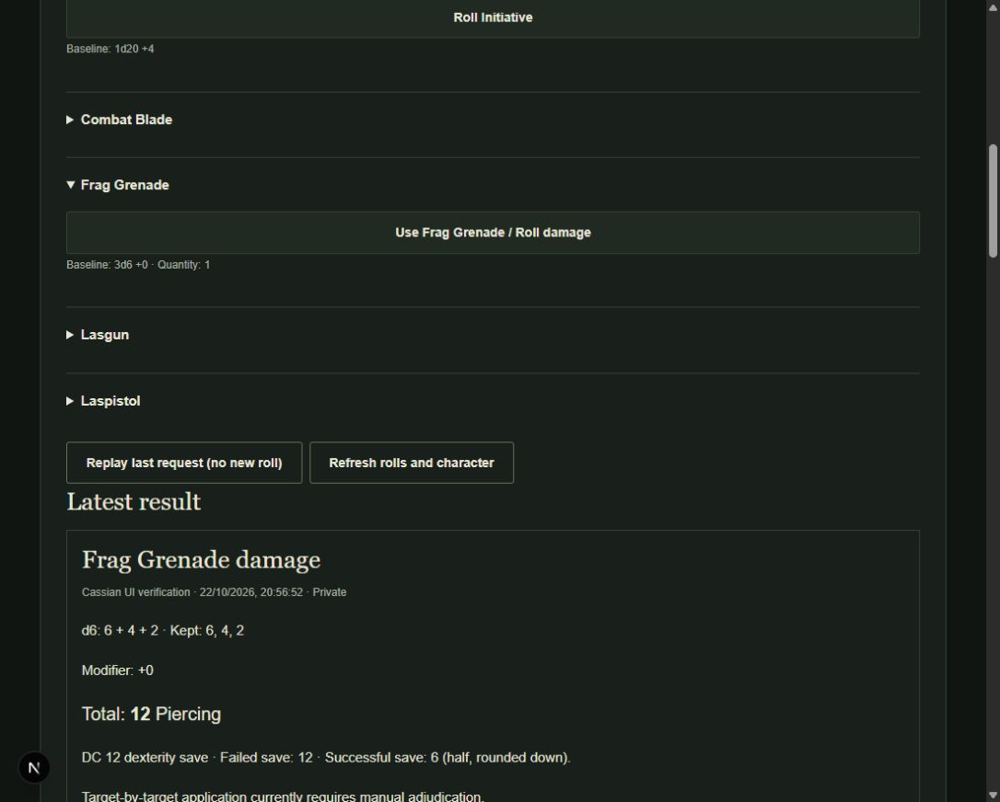

# Production browser dice rolling and history

Completed 2026-10-22 for `di-phb-1.0-narrow-v1`. The narrow character is playable with manual adjudication. Full-catalogue automation remains blocked by unresolved rulings; this pass adds no game-design decisions.

1. **Dice Engine:** server-only resolution with serializable individual dice, kept/discarded values and indices, modifiers and totals. Supports multiple groups, d4/d6/d8/d10/d12/d20/d100, keep-highest/lowest, bounded requests and stable tie handling. The production API exposes only canonical baseline rolls; generic advantage/critical mechanics are not enabled by this capability.
2. **RNG:** injectable `DieSource`; production uses Java `SecureRandom.nextInt(bound) + 1` for unbiased bounded sampling. Tests inject deterministic values. The browser never generates authoritative outcomes.
3. **Migration:** V5 creates `character_rolls`, owner/request uniqueness, character ownership and pinned-profile foreign keys, parent-result linkage and a newest-first history index. V1–V5 succeeded on an empty PostgreSQL 17.6 database; existing V4 preview/test databases upgraded to V5. History is append-only through the API; deleting its character cascades its private history.
4. **API:** authenticated owner-only `GET /api/characters/{id}/rolls/options`, `POST /api/characters/{id}/rolls`, `GET /api/characters/{id}/rolls?limit=25`. Ownership failures return 404; unknown fields are rejected. The server reconstructs definitions and modifiers from persisted character state and its stored ruleset snapshot.
5. **Categories:** 35 options: six ability checks, 15 skill checks, six saves, initiative, attack/damage for Lasgun, Laspistol and Combat Blade, and Frag Grenade damage. Finesse accepts only canonical Strength/Dexterity choices. Optional linked damage validates parent owner, character, action, ability and ruleset. Natural 20/1 and critical candidates are recorded without automatic hit or critical damage application.
6. **Controls:** native labelled buttons, grouped disclosures, Finesse selector, explicit grenade confirmation, pending-state disabling, live feedback, error handling, state refresh and textual results. Builder preview still does not execute rolls. Current grenade quantity is displayed.
7. **History:** immutable stored JSON results retain the resolved definition, context, profile/digest, engine version, timestamp, dice, total, parent, visibility and state versions. Default newest 25 results; API limit 1–50 and `hasMore`. Older rows remain stored; pagination beyond this bounded recent view is not implemented. PRIVATE is the only accepted visibility. Display never recalculates old results.
8. **Idempotency:** owner-scoped request UUID plus canonical payload digest (including character). Identical retries return the original result before stale-state/resource checks; changed payload returns 409. Transaction-scoped advisory locking serializes duplicate requests. Uncertain frontend failures retry the same UUID. Newly recorded results contain the original permitted request, enabling replay from history after reload.
9. **State version:** every new execution validates the supplied expected version against locked current runtime state. Ordinary rolls do not increment it. Committed grenade use increments it once. Different concurrent requests using the same old version cannot both consume. Unsupported conditions/temporary effects fail closed.
10. **Grenade transaction:** confirmation, resource availability, secure roll, quantity decrement, runtime-version increment and result insert share one database transaction. Insert failure rolls everything back. Idempotent replay consumes nothing. Approved PHB-059 half-on-success uses floor rounding. Target-by-target application remains manual; generic-018 is not resolved or automated.
11. **Backend:** 43 passing tests (25 retained, 18 added), including RNG boundaries, keep/discard, all categories, finesse, parents, tampering, ownership, pinned profile, exhaustion, stale versions, identical and distinct-key concurrency, forced rollback and immutable private history. Verified both upgraded and fresh PostgreSQL databases.
12. **Frontend:** 28 passing tests (14 retained, 14 added), covering pending and error states, minimal payload, Finesse, confirmation/cancel, quantity refresh, exhaustion, exact retries, fresh-mount history, persisted-request replay, linked damage and accessible text. TypeScript `tsc --noEmit` passes.
13. **Content:** 95 passing tests. Canonical snapshot and rulings are unchanged. No unresolved ruling was inferred or replaced.
14. **Build:** backend `test installDist` PASS using JDK 21 / Gradle 8.14.3. Frontend production packaging UNVERIFIED: `next build --webpack` failed with Windows EPERM creating `.next/types/app/register`. Development compilation and real browser flow passed; no successful production package is claimed.
15. **Browser acceptance:** PASS on real Next proxy/cookie authentication, Ktor and PostgreSQL. Opened existing Cassian UI verification; keyboard-activated Strength (3+3=6), Athletics (11+5=16), initiative (6+4=10), Lasgun attack (18+4=22), linked Lasgun damage (6+2=8 Radiant), Dexterity Combat Blade attack (12+4=16). Confirmed grenade use yielded 6+4+2=12 Piercing, DC12 Dexterity, success6, quantity2→1. Reload retained quantity1 and all seven history rows. Replaying the persisted grenade request returned the same dice, total and 20:56:52 timestamp; quantity stayed1 and history stayed seven rows. Desktop evidence below; separate physical mobile-device acceptance was not performed.
16. **Docker:** UNVERIFIED. `docker info` cannot connect to the absent `dockerDesktopLinuxEngine` pipe. No successful Compose startup is claimed, consistent with the owner's accepted limitation.
17. **Manual limits:** target AC/hits, critical damage, conditional features, range adjudication, target saves, multi-target grenade policy, damage application, ammunition and limited-use resources remain manual. No campaigns, broadcasting, GM/monster rolling, initiative tracker, full catalogue or 3D simulation were added. Dice presentation accepts TEXT_ONLY/2D/3D mode names but currently renders text for every mode; this is an extension boundary, not implemented animation.
18. **Next task:** optional 3D browser presentation for authoritative DiceRollResults, retaining reduced-motion/text fallbacks and making no changes to resolution logic. Resolve the local production-packaging/Docker environment before deployment validation.

## Subsequent presentation milestone

[3D dice presentation](THREE_D_DICE_PRESENTATION.md) adds optional visuals without changing the API or server rules. Player-facing history replay is now presentation-only; uncertain-request recovery still uses the original idempotent server request.
