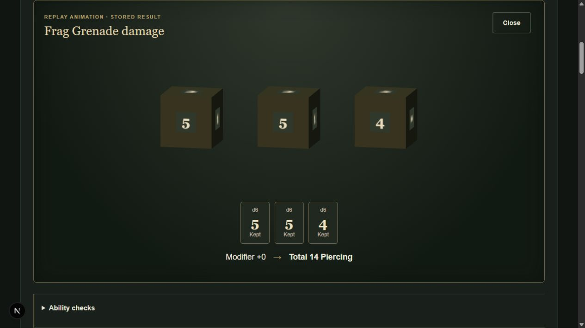

# 3D dice presentation and roll UX

Completed 2026-10-22. This is a presentation-only change to the validated narrow character sheet. No backend rules, migrations, canonical content, human rulings or resource-consumption logic changed.

1. **Technology:** Three.js 0.186.1, with TypeScript declarations 0.186.0. Direct Three.js keeps the integration small and avoids a React scene framework or runtime physics engine. Its [WebGLRenderer](https://threejs.org/docs/pages/WebGLRenderer) uses WebGL2; unsupported devices fall back to text. The declarations bring development-only dependencies (including Rapier types); the application does not import or execute a physics engine.
2. **Architecture:** completed `RollResult` → pure `presentRoll` → `DicePresentation` → lazy `dice-renderer`. The model copies individual values, stable group/index identities, kept/discarded state, label, category, modifier, total, natural and critical metadata, and damage type. The renderer has no API client, character state or RPG mechanics. Authoritative text is immediately visible, independently of animation.
3. **Shapes:** tetrahedron d4, cube d6, octahedron d8, stylised ten-face pentagonal bipyramid d10, dodecahedron d12 and icosahedron d20. d100 values pass through the presentation model and remain textual; a future tens/units adapter can extend presentation without changing results. Pools above 20 dice use complete textual fallback instead of crowding or omitting outcomes.
4. **Predetermined results:** face labels are assigned once in a stable order. Each supplied value selects its face quaternion before animation. A scripted 1.15-second entrance, rotation and settle ends at that orientation with a small readability/depth tilt. No client RNG or top-face physics detection exists. Geometry tests verify every face of all six shapes settles dominantly toward the viewer. The tray holds the result until closed and offers Skip animation.
5. **Reduced motion:** both the explicit setting and live `prefers-reduced-motion` changes select static dice/value cards. System reduced motion takes priority over 3D. No tumbling or renderer initialization is needed in this mode.
6. **Text only:** all dice, kept/discarded labels, modifier and stored total remain available. Roll execution, history and manual adjudication text work without WebGL. History remains text-first.
7. **WebGL fallback:** lazy import, renderer construction/render failure and context loss are isolated from the action request. The tray says “3D dice unavailable. Showing standard roll result.” and retains all values. Closing or unmounting disposes the renderer. Unsupported/oversized visual pools also retain their complete text. No failure causes a retry or new roll automatically.
8. **Sound:** optional low-volume synthesized settle tap, off by default; no external audio assets or music. Browser audio is unlocked by user interaction; unavailable/suspended audio never blocks results. Sound is currently a 3D settle accent, not a separate text-mode notification. Physical audio playback was not auditioned during acceptance.
9. **Preferences:** 3D / Reduced Motion / Text Only and Sound On / Off persist in localStorage under `dark-imperium.dice-presentation.v1`. Values are validated and storage failures are harmless. These settings are outside canonical content and character records.
10. **Replay:** Latest result → Replay animation and history → Replay Dice only replay the stored presentation locally. They make no roll request, consume no resources and add no history row. The tray explicitly labels stored-result replay. Uncertain network outcomes retain the separate Retry same request control and the original request UUID for authoritative recovery.
11. **Roll Again:** non-consumable latest results can submit a fresh UUID with current server option/version/profile and permitted ability context. This creates a new authoritative result/history entry. Consumables never expose this shortcut; another grenade use requires the existing confirmation and available quantity.
12. **Sheet UX:** adjacent closable tray; immediate textual totals; grouped controls; brass/dark-metal visual treatment; visible kept/discarded labels and strike-through; modest natural 20/1 emphasis without inventing critical effects. Results are scrolled into view without moving keyboard focus. Existing confirmation wording, linked damage, grenade full/half values and manual-target note remain intact.
13. **Frontend tests:** 46 PASS (previous 28 retained/adapted to local replay semantics plus 18 added). Covers model fidelity, multiple/equal dice, discarded identity, authoritative critical metadata, d100 preservation, every geometry face, preference parsing/persistence, reduced motion, text-only, initialization/context-loss fallback, renderer reuse/cleanup, skipping, fresh-UUID Roll Again, and grenade/history replay without requests. TypeScript PASS.
14. **Backend tests:** all 43 PASS against real PostgreSQL using the existing V1–V5 schema. Server source unchanged; ownership, idempotency, concurrency, pinned rulesets and transactional grenade consumption retain their existing coverage.
15. **Content tests:** all 95 PASS. No additional PHB mechanics or unresolved rulings were introduced.
16. **Browser acceptance:** PASS on the real Next proxy, cookie-authenticated API and PostgreSQL, using saved Cassian UI verification. Initiative: d20=3, total7. Lasgun attack: d20=9, total13, visible face9. Lasgun damage: d8=2, total4 Radiant, visible face2. Confirmed grenade: d6 values5/5/4, total14 Piercing, full14/half7; quantity1→0 after success. Reload and history replay rendered the same three values, quantity stayed0 and history stayed11 entries. Text Only initiative then succeeded with8+4=12. Roll Again created a distinct history entry with3+4=7 and a new timestamp. Reduced Motion displayed static cards; reload retained that preference. Final history had13 rows. Screenshot below captures local grenade replay. WebGL failure is exercised by component tests rather than forcibly changing browser/GPU settings.
17. **Build verification:** frontend TypeScript and development compilation PASS; backend Gradle test build PASS. Full frontend production packaging remains UNVERIFIED: `next build --webpack` failed with Windows EPERM creating `.next/types/app/(archive)/compendium`. No successful production bundle is claimed. New dependency versions/integrities are pinned; frozen lockfile validation passed. Local pnpm project-registration symlinks were unavailable, so dependencies were materialized from official registry packages for verification; the committed package-manager version is unchanged.
18. **Docker:** UNVERIFIED, as previously accepted by the owner. `docker info` still cannot connect to the absent `dockerDesktopLinuxEngine` pipe.
19. **Performance:** Three.js loads only for a completed result in 3D mode. A renderer, geometry cache and numeral texture cache are reused across rolls; old meshes/materials are disposed, animation frames stop at settle, ResizeObserver handles tray changes, and pixel ratio is capped at1.5. Closing/mode change/unmount releases GPU resources. Browser checks showed responsive input and immediate text, but no numerical frame-rate or production bundle-size benchmark is claimed.
20. **Known limits:** scripted presentation rather than physical collisions; one default theme; stylised d10; percentile and oversized pools use text; manual gameplay adjudication remains unchanged. Responsive sizing, wrapping, three-column narrow layouts and reduced resolution are implemented, but physical mobile/tablet portrait/landscape acceptance remains unverified (the available browser controls do not expose viewport emulation). GPU behavior across browsers and physical audio playback need broader device testing. The production packaging environment remains a deployment-verification blocker.

Recommended next major milestone: expand the supported PHB character catalogue after approved answers to the remaining level1–3 Origin eligibility rulings, then publish additional validated Species, Origins, Classes and starting options. This recommendation does not resolve or authorize invented rulings. Complete deployment and device verification before shipping the new renderer.
