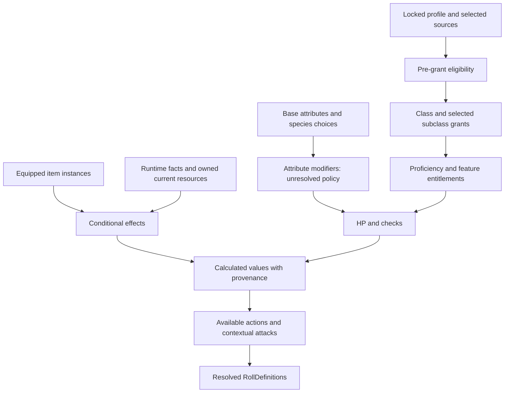

# PHB v1.0 calculation policies

These are source-scoped policies and offline conformance implementations in `tools/phb_policies.py`, not a playable profile or runtime engine. AUTOMATIC_INPUTS_REQUIRED means deterministic only after all named inputs have been resolved. A missing ability-modifier policy still blocks a real character even when a sum is known. No formula is imported from another RPG.

Printed page = PDF page − 13. All policy references below are PDF pages. The generic evaluation phases in RULES_EFFECTS describe interpreter capability, not proof of PHB stacking precedence.

## PHB-CALC-001 — Attribute modifiers

Automation: **BLOCKED**. Inputs: score. Output: modifier.

Order/formula: No formula located; do not evaluate a guessed floor((score-10)/2).

Stacking/caps/floors: None defined. Source PDF: 17, 18, 123.

## PHB-CALC-002 — Maximum wounds

Automation: **PARTIAL**. Inputs: class Hit Die, resolved Con modifier at acquisition, chosen die roll/fixed gain, feature contributions. Output: maximum HP.

Order/formula: Level 1: die maximum + Con; later d6/d8/d10/d12 fixed 4/5/6/7 or chosen roll + Con. Accumulate recorded gains, then only resolved feature policies. Retroactivity/floor needs ruling.

Stacking/caps/floors: No universal floor established. Source PDF: 17.

## PHB-CALC-003 — Current wounds

Automation: **PARTIAL**. Inputs: owned current HP, accepted damage/healing event, calculated maximum. Output: new owned current HP.

Order/formula: No mutation during recalculation. At 0 apply unconscious/death procedure. Max changes, healing overflow and negative healing require explicit policy.

Stacking/caps/floors: No invented reconciliation. Source PDF: 31, 32.

## PHB-CALC-004 — Defence / AC

Automation: **PARTIAL**. Inputs: one source armour expression, resolved Dex, shield, applicable cover and effects. Output: AC for this attack.

Order/formula: Explicit base+Dex rows: base+min(Dex,cap) when cap stated; negative Dex is retained. Shield +2. Cover applies only to crossing attack. Unarmoured/ambiguous bases/stacking remain blocked.

Stacking/caps/floors: Caps only as printed. Source PDF: 31, 42.

## PHB-CALC-005 — Movement

Automation: **PARTIAL**. Inputs: species base in ft, source modifiers, conditions, runtime mode. Output: Speed in ft.

Order/formula: Use species base; apply explicitly supported changes. Grappled: zero and cannot benefit from speed bonuses. Exhaustion uses cumulative levels; conflicting multiplication order unresolved.

Stacking/caps/floors: No universal inferred floor. Source PDF: 23, 24, 32, 33.

## PHB-CALC-006 — Initiative

Automation: **AUTOMATIC_INPUTS_REQUIRED**. Inputs: resolved Dex modifier, applicable feature modifiers. Output: initiative roll intent.

Order/formula: d20 + Dex modifier + source-defined resolved bonuses. Squad Drill requires its chosen ally/context.

Stacking/caps/floors: Same-source dedup; cross-feature stacking unresolved. Source PDF: 123, 27, 29.

## PHB-CALC-007 — Attack modifiers

Automation: **AUTOMATIC_INPUTS_REQUIRED**. Inputs: relevant resolved ability, proficiency entitlement, level, context. Output: attack modifier.

Order/formula: Ability + proficiency once if proficient, then only applicable approved modifiers. Finesse permits Str/Dex; no universal weapon ability guessed.

Stacking/caps/floors: No cap specified. Source PDF: 35, 123.

## PHB-CALC-008 — Damage modifiers

Automation: **PARTIAL**. Inputs: weapon components, ability/context, property/feature triggers. Output: typed components.

Order/formula: No complete personal weapon default ability rule located. Mounted attack-roll damage adds Dex once; mounted area adds none. Offhand Light melee excludes positive ability unless feature.

Stacking/caps/floors: No global stacking invented. Source PDF: 32, 115.

## PHB-CALC-009 — Skill bonuses

Automation: **AUTOMATIC_INPUTS_REQUIRED**. Inputs: skill or GM-chosen ability, resolved modifier, entitlement, level. Output: bonus.

Order/formula: Ability modifier + PB if proficient. Explicit GM ability reassignment is context, not content rewrite.

Stacking/caps/floors: PB once. Source PDF: 18, 123.

## PHB-CALC-010 — Saving throws

Automation: **AUTOMATIC_INPUTS_REQUIRED**. Inputs: resolved relevant ability, granted save proficiency, level. Output: save bonus.

Order/formula: Ability modifier + PB only if save proficiency is granted.

Stacking/caps/floors: PB once. Source PDF: 18, 123.

## PHB-CALC-011 — Proficiency

Automation: **AUTOMATIC**. Inputs: level 1..20. Output: PB.

Order/formula: 1–4:2;5–8:3;9–12:4;13–16:5;17–20:6. Use table thresholds; no extrapolation.

Stacking/caps/floors: Add once to a roll. Source PDF: 15, 123.

## PHB-CALC-012 — Expertise

Automation: **BLOCKED**. Inputs: entitlement and proficiency. Output: bonus.

Order/formula: Referenced but not defined.

Stacking/caps/floors: Unknown. Source PDF: 62, 65, 68, 71, 77, 80.

## PHB-CALC-013 — Critical thresholds

Automation: **PARTIAL**. Inputs: natural retained attack face, weapon/feature scope. Output: critical decision.

Order/formula: Ordinary natural20; only apply explicit scoped expanded ranges. Unconscious within5ft has special hit rule. No automatic-success convention inferred.

Stacking/caps/floors: Conflicting expanded thresholds unresolved. Source PDF: 31, 33, 65, 123.

## PHB-CALC-014 — Critical damage

Automation: **AUTOMATIC_INPUTS_REQUIRED**. Inputs: ordinary attack damage dice/components and flat modifiers. Output: transformed dice.

Order/formula: Double ordinary attack damage dice counts; flat modifiers once; then explicit critical extra dice. Multi-die selection unresolved for personal properties, mounted first listed die explicit.

Stacking/caps/floors: Technical dice limits are not game caps. Source PDF: 31, 121.

## PHB-CALC-015 — Advantage/disadvantage

Automation: **AUTOMATIC**. Inputs: resolved presence of each. Output: 1d20 or 2d20 keep high/low.

Order/formula: Multiple same type do not stack; both cancel regardless of source count. Missing conditions remain unknown.

Stacking/caps/floors: At most two dice for this policy. Source PDF: 18.

## PHB-CALC-016 — Resistance

Automation: **BLOCKED**. Inputs: typed components, applicable resistance/bypass. Output: modified damage.

Order/formula: General factor/rounding not specified; do not infer half.

Stacking/caps/floors: Unknown stacking. Source PDF: 35, 42, 116.

## PHB-CALC-017 — Vulnerability

Automation: **BLOCKED**. Inputs: typed components, explicit vulnerability. Output: modified damage.

Order/formula: No general definition located; do not infer double.

Stacking/caps/floors: Unknown. Source PDF: 15, 116.

## PHB-CALC-018 — Immunity

Automation: **PARTIAL**. Inputs: target-kind and effect eligibility, explicit immunity. Output: excluded effects/components.

Order/formula: Hull poison/radiation cannot harm it; psychic only if affects objects/machinery. Creature fear immunity does not imply psychic-damage immunity. General precedence with other modifiers requires review.

Stacking/caps/floors: No umbrella energy/physical group. Source PDF: 116.

## PHB-CALC-019 — Equipment modifiers

Automation: **PARTIAL**. Inputs: active owned item instances, host/scope, usage. Output: context contributions.

Order/formula: Only eligible source effects; do not grant carried items automatically. Signature Wargear maximum three active, switched during rest/downtime.

Stacking/caps/floors: No generic duplicate-item stacking. Source PDF: 104, 124.

## PHB-CALC-020 — Armour modifiers

Automation: **PARTIAL**. Inputs: one explicit AC expression and penalties. Output: base and scoped changes.

Order/formula: Separate AC base from damage reduction/resistance and condition modifiers. Register profile derivations for explicit expressions.

Stacking/caps/floors: Competing bases unresolved. Source PDF: 42.

## PHB-CALC-021 — Shield modifiers

Automation: **PARTIAL**. Inputs: shield equipped, hands, conditional features. Output: AC contribution.

Order/formula: Shield +2 and one hand explicit. Riot Shield subclass +1 while shield used now structured; shove advantage stays manual.

Stacking/caps/floors: Multiple shields unresolved. Source PDF: 42, 62.

## PHB-CALC-022 — Resource maximums

Automation: **PARTIAL**. Inputs: feature definition, level/PB. Output: maximum uses.

Order/formula: Use exact feature maximum only; once-per-rest=1, PB-per-rest=PB. Do not impose maximum on Warp Pressure.

Stacking/caps/floors: No generic max. Source PDF: 50, 62, 86, 95.

## PHB-CALC-023 — Resource recovery

Automation: **PARTIAL**. Inputs: accepted rest/event, resource recharge rule. Output: updated uses.

Order/formula: Recover only explicitly matching rest/event; no recalculation/refresh recharge.

Stacking/caps/floors: One event applied once is technical idempotency. Source PDF: 32.

## PHB-CALC-024 — Rest recovery

Automation: **PARTIAL**. Inputs: time/rest qualification, spent Hit Dice, food/water/safety. Output: HP, HD, feature/pressure recovery.

Order/formula: Short >=1h: spend HD and heal roll+Con. Long >=8h/6sleep: restore HP; regain up to half total HD min1; pressure0; exhaustion-1 with food/water/safe rest. Once/24h; no Corruption removal. Odd HD rounding unresolved.

Stacking/caps/floors: Do not exceed spent HD; odd-half policy needs ruling. Source PDF: 32, 33, 95.

## PHB-CALC-025 — Level scaling

Automation: **AUTOMATIC_INPUTS_REQUIRED**. Inputs: class level, explicit source table. Output: grants/values.

Order/formula: Use exact source thresholds, no extrapolation; levels1..20. Keep source occurrence identities.

Stacking/caps/floors: No implicit multiclassing. Source PDF: 17, 50–84.

## PHB-CALC-026 — Class progression

Automation: **PARTIAL**. Inputs: chosen class/subclass, level, prior answers. Output: grants and pending choices.

Order/formula: 12 class tables;45 subclass progressions. Selected subclass grants its rows, parent grants choice once. Upgrades still manual until replacement semantics mapped.

Stacking/caps/floors: ASI amount/repeats unresolved. Source PDF: 50–84.

## PHB-CALC-027 — Psychic resource calculation

Automation: **PARTIAL**. Inputs: pressure,tier,empower,scoped cost modifiers. Output: pressure and Perils intent.

Order/formula: Gain1/2/3 plus 1 empowered before resolving power/Perils; after power d20<=pressure;severityd20+pressure;31+ open. Rest0. Odd post-Perils rounding/floor unresolved.

Stacking/caps/floors: No pressure cap; specific minimum cost1 only when stated. Source PDF: 91, 95.

## PHB-CALC-028 — Vehicle calculations

Automation: **AUTOMATIC_INPUTS_REQUIRED**. Inputs: resolved post-mitigation components,DT,Armour-Breaking,driver,Handling. Output: hull damage/checks.

Order/formula: Per hit sum components after resistance;DTfloor(DT/2) if Armour-Breaking;below0 else full. Driving Dex(Vehicles)+Handling; mounted attacks proficiency once. Hull damage does not also damage crew.

Stacking/caps/floors: Per-mount/round limits and crew state required. Source PDF: 114–116, 121.

## PHB-CALC-029 — Weapon and psychic save DC

Automation: **AUTOMATIC_INPUTS_REQUIRED**. Inputs: resolved ability,PB,action context. Output: DC.

Order/formula: Weapon8+PB+weapon ability;psychic8+PB+Int/Wis;grenade8+PB+Dex;mounted8+Dex+PB only if trained.

Stacking/caps/floors: No unspecified bonuses. Source PDF: 35, 91, 115, 123.

## PHB-CALC-030 — Bloodied

Automation: **AUTOMATIC_INPUTS_REQUIRED**. Inputs: current and positive maximum HP. Output: boolean state.

Order/formula: 2*current<=maximum. No effect by itself. Below-half features use strict <, not Bloodied.

Stacking/caps/floors: Maximum<=0 unresolved. Source PDF: 32, 123.

## Dependency model

Validate the statistic/unlock DAG before evaluation. Unknown dependencies propagate unresolved. Eligibility sees the pre-grant snapshot; an option cannot grant its own prerequisite. A later acquired prerequisite requires revalidation, not a fixed-point guess. Class↔progression references are legal reference cycles; numeric or unlock cycles fail. Self-referential actual rules need an explicit base snapshot/phase ruling. Recalculation never spends/heals or advances turns. `topological_order` tests cycle rejection.

## Remaining global recovery question

The PHB does not specify rounding for half Hit Dice recovered on a long rest. Supply that rounding rule before automatic resource commits.
