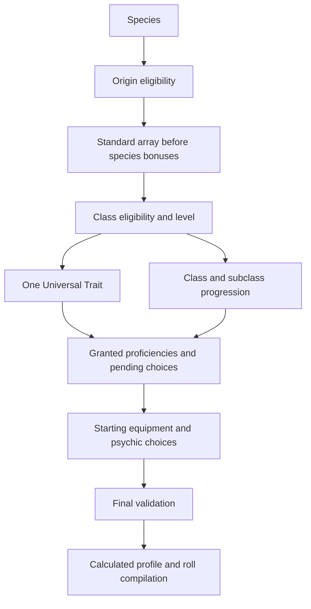

> **Current Frag gate pass:** [Results](../import/PHB_FRAG_GATE_REPORT.md). Narrow profile PLAYABLE_WITH_MANUAL_RULES; narrow builder data READY_WITH_MANUAL_RULES. 93 tests; 948 drafts; 310 candidates. Generic Blast and 31 original rulings remain unresolved. Earlier pass statements below are historical.

> **Current pass:** [Minimum rulings and narrow proof](../import/PHB_MINIMUM_RULINGS_REPORT.md). Five rulings approved, 31 unresolved. 948 canonical drafts; 310 candidates; 81 content tests pass. The narrow core calculates, but a mandatory Frag Grenade save outcome keeps playable readiness BLOCKED. Earlier sections below describe historical scope.

# Character creation flow and partial projection

Source order: PHB v1.0 §2, printed 4/PDF 17: species → Origin → ability scores → class → one Universal Trait → record proficiencies/saves/features → starting equipment → calculate AC/HP/attack/DC → identity/warband role. Campaigns usually start at level 3; the source supports1–20. This pass does not choose a campaign level or approve alternative attribute generation.

Source order is presentation; dependencies govern revalidation. Species constrains Origin/class and attribute choices. Class/level grants subclass choice; Psyker selects its discipline at 1, most others at 3. Origin/class/feature grants open skill choices. Subclass parent and unlock level are both required. Attributes may gate later options. Powers need class/list/tier eligibility, known-count limits and canonical power/action references. A source-supported count is not permission to select any power.

Four canonical choice pools now exist: `di.choice.creation.species`, `.origin`, `.class`, `.universal_trait`. Their options retain referenced prerequisites, including unresolved Origin gates. They do not constitute a published profile. Existing grants/answers use the CHARACTER_BUILDER contract; no second rules language is introduced.

## Offline validation adapter

`tools/character_creation.py` exposes `validateCharacterSelection(characterDraft)` and its snake_case equivalent. Input uses existing CharacterModel `selections.species`, `background`, `classes`, pre-species `attributes`, `answers`, plus owned `inventory`. This adapter supports one class and the emitted once-per-actor option choices. It reports INVALID for proven violations, INCOMPLETE for missing/blocked dependencies, and reserves VALID for a complete approved configuration. No current complete PHB draft can be VALID while the profile and global calculation rules remain blocked.

Every diagnostic has code, field, message and rulingIds. `eligibilityStatus` covers only species/Origin/class/subclass prerequisites, explicitly named in `eligibilityScope`; it is not a legal-character certificate. Feature/choice/equipment violations still invalidate the overall result. No client-supplied fact can approve a human ruling. This is an offline conformance adapter, not the backend authorization/ownership service or full production choice-occurrence validator.

The partial projection follows CHARACTER_MODEL's separation: selected data stays in the input; calculated values contain source-supported post-species scores, base walk speed and proficiency; classTraining carries source-cited Hit Die and save attributes; knownPowerCounts copies exact class-table rows. Features/manual entries carry source IDs. Unknown modifiers/HP/AC/skills/saves/resources/resistances are explicit nulls plus unresolvedFields, not zero. Empty actions/rollDefinitions are marked unresolved, not an assertion the character has no actions.

Owned current HP, ammunition, pressure changes and rest/turn state are never mutated by projection. Full calculated output still needs a reviewed profile/lock, complete class/choice/equipment/power data, effect derivations and runtime action/RollDefinition compiler. A draft projection has no lock digest and cannot authorize gameplay.

## Validation and dependency limits

Unknown requirements propagate INCOMPLETE. Missing/wrong-kind references, duplicate/ungranted answers, wrong parents/unlock levels, invalid standard array and illegal equipped items return field-specific errors. Only selected subclass grants are expanded; source/manual text is never executed. Cyclic unlocks fail explicitly; the prior topological dependency tests remain in place. Full persistent occurrence provenance, exclusions, multiclassing, resource transactions and campaign authority are future production responsibilities, not silently accepted capabilities.
