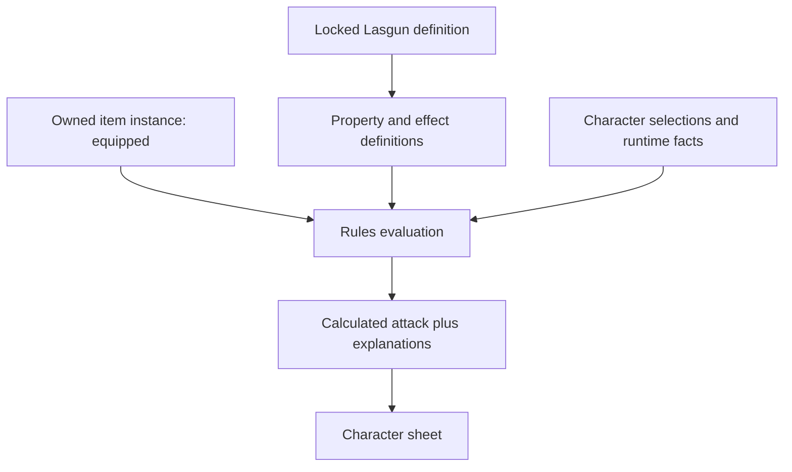

# Content architecture

## Six boundaries

| Layer | Owns | Must not own |
| --- | --- | --- |
| Content definitions | Species, classes, equipment, actions, rule vocabulary, source citations and reusable feature definitions | A player's current wounds, equipped instances or campaign turn |
| Character-owned state | Selections, inventory instances, resources, notes, advancement history and persistent conditions | Copies of mutable catalog definitions or recalculated totals |
| Rules/effects | Validated operations, typed predicates, scaling tables, costs, durations and recharge definitions | Arbitrary executable code or hidden UI behavior |
| Calculated values | Derived statistics, contextual attacks, grants, explanations and unresolved conditional contributions | Authoritative spendable resources or silently rolled dice |
| Runtime state | Encounter participants, initiative/turn, distances, targets, rolled outcomes, active durations and recorded adjudications | Canonical creature, action or weapon definitions |
| Presentation | Forms, descriptions, selection widgets, sheets and provenance displays | Species-name checks, stacking decisions, costs or legality checks |

The sheet displays engine results and available actions. It never reconstructs mechanics from prose or a content name. Both the builder and future combat tools use the same rule contract; the API remains authoritative for legal selections, resource changes and ownership.

## Common content envelope

Each record is `{schemaVersion, id, kind, revision, name, summary, descriptionMarkdown, lifecycle, verification, sources, tags, data}`.

| Field | Contract |
| --- | --- |
| `schemaVersion` | Required integer `1`; format version, not game edition |
| `id` | Required permanent namespaced ContentId; see CONTENT_IDS |
| `kind` | Required registered entity kind; agrees with the kind segment of `id` |
| `revision` | Required positive integer; immutable once published in a package |
| `name` | Required 1–160 characters; localized display can be added separately |
| `summary` | Required plain text, at most 500 characters, for results/cards |
| `descriptionMarkdown` | Required string; safe Markdown subset, possibly empty for taxonomies |
| `lifecycle` | Required `draft`, `published`, `deprecated` or `withdrawn` |
| `verification` | Required `placeholder`, `transcribed`, `reviewed` or `authoritative`; not a runtime permission |
| `sources` | Required nonempty list of SourceCitation objects |
| `tags` | Required list of ContentRefs of kind `tag`, unique by ID |
| `data` | Required typed payload from ENTITY_TYPES / DOMAIN_SCHEMAS |
| `aliases` | Optional display/search strings, not identity aliases |
| `replacedBy` | Optional same-purpose ContentRef; advisory, never automatic substitution |
| `extensions` | Optional namespaced editorial metadata; never executable and never mechanically interpreted without a versioned capability |

`ContentRef` is exactly `{"id":"example.weapon.lasgun"}`. Resolution uses the actor's ruleset lock, never a mutable global “latest” query. A slot's expected kind is checked by the validator. Local IDs such as effect `movement_bonus` are meaningful only within the owning content revision. Runtime IDs (UUIDs for an item instance or character) are a different type.

`SourceCitation` is `{sourceId, sourceVersion, locator, verificationNote?}`. `sourceId` resolves in the source registry, not the content registry. `locator` requires `sectionKey` and `heading`; it may include `printedPage`, `pdfPage`, `paragraphKey` and `excerptHash`. Page fields are optional positive integers. Source registry entries carry title, edition label, language, file SHA-256 and origin/rights notes where known. Source bytes may be private. No page number is a stable content ID.

## Shared structures

| Type | Shape / meaning |
| --- | --- |
| `Requirements` | Typed Predicate; absent means no extra prerequisite; used in an expressly named evaluation context |
| `PropertyUse` | `{property: ContentRef, arguments: object}`; values checked against that property's named parameter declarations |
| `FeatureOwner` | Required `features: ContentRef[]` (kind feature); optional `choices: ContentRef[]`, `requirements: Predicate` |
| `Distance` | `{value: nonnegative rational, unit: "m"\|"ft"}`; unit must match the locked profile or be explicitly converted on import |
| `Weight` | `{value: nonnegative rational, unit: "kg"\|"lb"}` |
| `Dice` | `{count:1..100, sides:2..1000, bonus: bounded integer}`; no formula string, reroll or explosion semantics hidden in notation |
| `Amount` | `{currency: ContentRef, units: nonnegative integer}` in the currency's minor unit; no floating-point money |
| `RuleUse` | Reference to a `rule` with a matching role, not an arbitrary textual override |
| `Cardinality` | `{min:nonnegative integer,max:integer >= min,unique:boolean}` plus choice scope |

All size bounds are technical safety limits, not RPG rules. A publisher may tighten them. The proposed engine uses exact rational arithmetic until an explicit rounding step; JSON decimal input is parsed as decimal text, not binary floating point.

## Repository format

Use UTF-8 **JSON** as the canonical source format, one entity per file under `content/packages/<package-id>/entities/<kind>/<key>.json`. Use JSON Schema 2020-12 for future structural validation, plus a semantic validator. A manifest lists dependencies, source registry entries and capabilities. A lock materializes exact revisions and digests. The examples use a single catalog only to keep this review fixture easy to inspect.

JSON has predictable parser behavior, explicit types, good schema support and no YAML implicit scalars, custom tags or executable constructors. Markdown belongs in display fields; long text can be edited by an admin editor and exported back to JSON. Database-only authoring would lose reviewable source history. YAML may be accepted as an author convenience later, but must normalize to canonical JSON before review/import; it is not a second authoritative representation.

Git diffs review text and mechanics together. Arrays whose order is meaningful (steps, priorities, options) preserve it. For hashing, use RFC 8785 canonical JSON over the complete record, excluding no hidden mutable fields; publishing changes lifecycle before computing the digest. A semantic change is a new revision.

## Persistence and expansions

The future relational design needs content identity, immutable revisions, packages, locks, sources and typed detail/JSON payloads. This is a logical contract, not a demand to replace all current tables at once. UUID database keys can map to permanent ContentIds. Character references bind to a lock and content identity, while owned item instances stay separate rows.

An expansion supplies packages, dependencies and new entities using registered existing kinds. Chapters are affiliation options, their traits are features, and their equipment uses the same item contracts. New mechanics outside the interpreter's known capability list require a reviewed capability extension or an explicitly manual rule. Data-driven does not mean every imaginable mechanic executes without code changes.

## Metadata for future compendium/admin tools

Search indexes name, aliases, summary and sanitized description; facets include kind, tags, faction references, source/package, verification, lifecycle and kind-specific category/discipline/threat fields. Numeric threat sorting is allowed only within the same named rating scale. Sort names use a locale-aware derived key, not the permanent ID. Compendium URLs use `/compendium/<kind>/<encoded-content-id>` with a ruleset/lock context; optional pretty slugs redirect without becoming identity.

Structured relations (parent class, discipline, faction membership, required proficiency) remain explicit references. Tags classify; they do not replace those relations. Content editors need source/citation fields, safe rich text, reference pickers, typed effect and prerequisite builders, choices/bundles, progression rows, dice/unit inputs and change-impact previews. Draft permissions, publication approvals and homebrew audience are separate access-control metadata, never trusted because a JSON file says `authoritative`.

## Integrated dice extension

Runtime dice requests/results/history are separate from catalog entities. Optional embedded RollTemplate structures resolve into immutable definitions through the pinned ruleset; no arbitrary expression evaluator is added. See [Integrated dice rolling](DICE_ROLLING.md).
