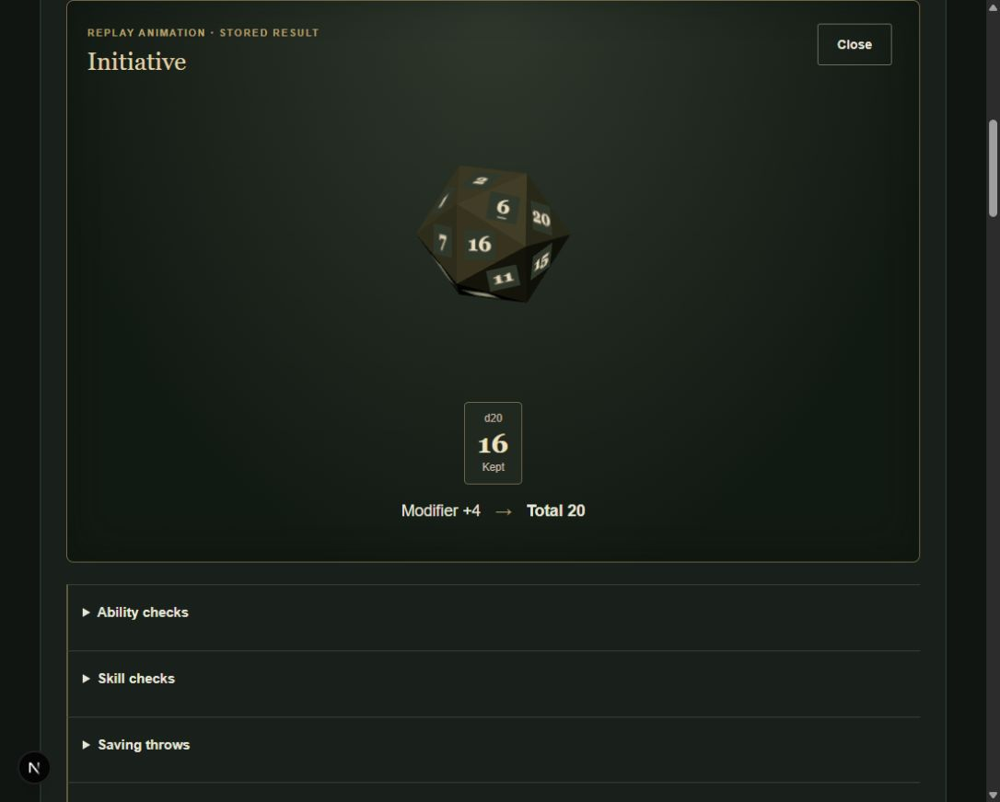

> Historical v1 release report. Current scope and verification: [Human tier-1 v2 completion report](HUMAN_TIER1_V2_REPORT.md).

# Origin approvals and first tier-1 publication

Completed 22 October 2026. This report supersedes the previous audit-only readiness state. The full catalogue remains PARTIAL; one additional path is certified and registered locally. No hosted deployment is claimed.

## Approved decisions

PHB-RULE-001 through 007 are RESOLVED independently. Exact approved sections, user provenance, UTC recordedAt, affected Origin IDs, source relationships and the SHA-256 of the supplied brief are retained in both ruling ledgers. The original ledger is **12 resolved / 24 unresolved / 36 total**. The separate PHB-RULE-059 Frag Grenade decision remains outside that denominator. Earlier approval records were not rewritten.

The detailed Origin Allowed Species entry overrides the summary matrix. NORMAL is legal without additional approval, subject to all other prerequisites. RARE requires explicit trusted GM approval. LIMITED requires approval for the specific combination and appropriate narrative justification; a generic rare-content permission cannot satisfy it. No approval infrastructure or client approval control was added.

## Updated matrix

| Status | Rows |
|---|---:|
| READY | 0 |
| READY_WITH_MANUAL_RULES | 2 |
| BLOCKED_BY_CONTENT | 292 |
| BLOCKED_BY_ENGINE | 63 |
| BLOCKED_BY_RULING | 0 |
| BLOCKED_BY_APPROVAL | 37 |
| UNSUPPORTED | 3746 |

Total: 4,140 family rows across 6 Species, 10 Origins, 12 classes, levels 1–3 and 45 subclasses. The two ready rows are the existing narrow path and the new tier-1 path, with their explicit trait/kit/choice limits. These rows do not certify every optional permutation. Status precedence is unsupported, certified, approval, ruling, content, then engine. Conditional feature ruling review and implementation gaps remain in each row; zero BLOCKED_BY_RULING here means no unresolved Origin prerequisite, not that the remaining 24 rulings are irrelevant to future paths.

See [full publication matrix](LEVEL_1_3_PUBLICATION_MATRIX.md) and [approved Origin table](LEVEL_1_3_ORIGIN_SCENARIOS.md). There are **18 NORMAL, 3 RARE, 1 LIMITED** Species/Origin pairs; the other 38 pairs are invalid. The legal-but-unapproved pairs contribute 37 family rows.

## Published profile and certified scope

Profile: `di-phb-1.0-tier1-v1`; digest: `d75739125210dd704ca0b3362a2c864a0fdd32b6b2765b0bbc137f5792971f32`; adapter: `phb-tier1-kotlin-v1`.

**New level-1 path:** Human / Hiveborn / Veteran / Twitchy. Standard array, all reviewed Human ability-score allocations, canonical skill choices, reviewed Broad Training weapon option and Veteran specialist-group choice remain backend-validated. Equipment is lasgun, laspistol, combat blade, equipped flak armour, two Frag Grenades and medpack. Autogun, auspex and other alternatives are not selectable. Hiveborn crowd-terrain exceptions and situational fear-save advantage remain visibly manual, as do existing Tactical Aim and other contextual procedures.

**New level-2 paths: none. New level-3 paths: none. Subclasses certified: none.** All 45 parent/progression relationships still validate, but that is not production certification. Newly unlocked features, selected resources and conditional rulings need further work. The existing data-driven builder consumes the new backend profile without React game-rule logic; it exposes only level 1 and the certified selectors. RARE/LIMITED messages are supplied by the profile, with no self-approval button. Tampered requests fail server validation.

The new immutable snapshot includes canonical records, resolved approvals, explicit allowlist, executable package, training, proficiency policy and availability policy. The exporter refuses to replace different bytes at the same release path. Existing characters load their stored snapshot and adapter; old creation requests remain supported by the registry. The original narrow digest remains `3d1235b3cb86ac5c8939c94a9c55964e07e1ce96d7b05d20966feb7dd78001af` and its source spec and bundled snapshot are unchanged. Frozen-release verification now checks the frozen snapshot, rather than attempting to rebuild it from a changing development catalogue.

## Implementation blockers progressed

- **PHB-CAT-001:** Added a generic structured package compiler for fixed quantity grants, exclusive/nested package choices, optional branches, proficiency grants, equip state and narrative/contact entries. It rejects unsupported items, invalid quantities, unknown/duplicate choices and equip-without-grant. The production Veteran branch uses this compiler. The other eleven class package definitions still need source-backed mapping; they are not implicitly certified.
- **PHB-CAT-002:** No speculative equipment promotions. Of 74 identified starting dependencies, 5 remain SUPPORTED, 1 MANUAL, 23 canonical COMING_LATER and 45 candidates BLOCKED. This is an identified union, not a claim that unresolved pools are complete. Approved aliases resolve to canonical IDs before compilation; runtime compilation never parses display text.
- **PHB-CAT-003:** Psyker/Warlock remain blocked. All 52 power candidates remain separate: 38 required Minor/Standard and 14 deferred Major. Evidence such as Assail includes source mechanics, but the canonical power schema, pool validation, psychic resources and multi-target execution boundaries are still incomplete. No invented power or manual shortcut was published.
- **PHB-CAT-004:** Registered the separate tier-1 adapter version and explicit whole-path gate. It shares the pinned calculation/projection/roll code with the unchanged narrow branch, adds approved level 1–3 fixed-HP and explicit armour/dexterity-cap policies and invokes the package compiler. Production certification is only level 1. Mandatory progression/resource calculations outside that branch remain blocked; higher-level numeric unit proofs do not publish those levels.
- **PHB-CAT-005:** Mapped Ratling Naturally Sneaky to a canonical Stealth proficiency grant and removed its duplicate prose-only grant. No non-Human species is published. Remaining core restrictions, size/equipment compatibility, Ogryn HP/unarmed effects, vision and conditional species procedures still require mapping and certification.

## Goldens and validation

Added actual tier-1 draft and independently expected mechanics/inventory/action/roll fixtures in backend test resources. Expected values include HP 11, AC 14, speed 30 ft, initiative +4, Stealth +4, History +1 and Intimidation -1 for the golden allocation. Existing family-readiness fixtures remain labelled as audits and are not converted into fake playable characters.

| Check | Result |
|---|---|
| Content | 122 passed: original 117 retained with updated approved-rule expectations, plus 5 Origin/schema/profile tests |
| Backend | 50 passed: previous 43 plus 6 tier-1/compiler/policy tests and 1 API persistence/roll/backwards-compatibility test |
| Frontend | 46 passed |
| TypeScript | Passed |
| Backend distribution | Gradle installDist passed |
| Migrations | Five existing migrations validated; preview schema up to date; no new migration |
| Frozen profiles | Narrow and tier-1 export checks passed |
| Browser | New path created, persisted, reopened and rolled; stored result replayed in 3D; original narrow character reopened |
| Production frontend build | Compilation and TypeScript passed; prerender failed with Windows EPERM mkdir under .next/server/app/login.segments/login |
| Docker startup | UNVERIFIED: Docker Desktop Linux engine named pipe absent |

Browser acceptance used `Mara Hiveborn acceptance` (`a2c8c563-b713-454b-b9ad-da27152ae707`). The persisted initiative result was 16 + 4 = 20, retained after reload. Local 3D replay did not create a second result. Existing `Cassian UI verification` (`fb2d077a-cc97-4b93-8db2-3f3d31e2d590`) reopened on narrow-v1 with HP 11/11, AC 14, exhausted grenade inventory and existing history intact. No level-2, level-3 or non-Human browser acceptance is claimed.

## Remaining gates and next milestone

Keep all remaining 24 rulings unresolved. Apply them only to selected mechanics: expertise 011; Constitution reconciliation/minimum HP 014; ASI 015; repeated talents 016; slash damage 026; Powered Carapace 028; Exo-frame 029; Ogryn flak 030; unarmoured/competing protection 032; stacking 058, plus runtime rules where actually exercised. Existing item-specific Frag rules do not resolve generic Blast 018. The matrix retains conditional feature review metadata instead of treating broad historical affected-entity lists as a dependency graph.

Next: certify additional NORMAL Human paths and complete selected level-2/3 feature/resource dependencies and golden fixtures. In parallel, map non-Veteran packages and mandatory non-Human mechanics. Once multiple level 1–3 paths are certified, implement advancement through levels 1–3 before considering levels 4–20. Trusted approval infrastructure, campaigns and encounters remain outside this iteration.
